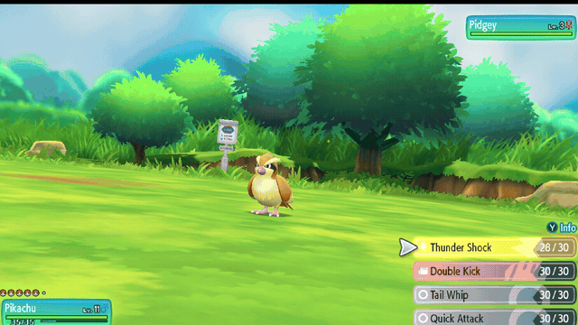
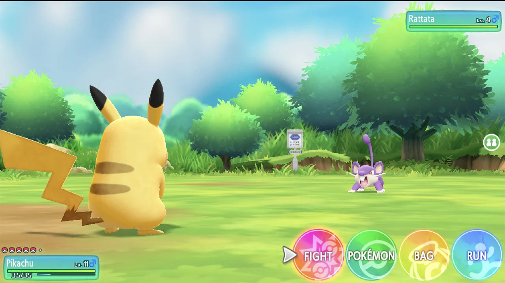
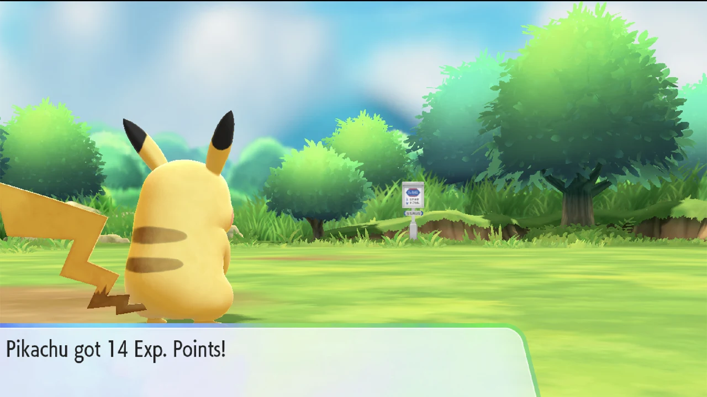
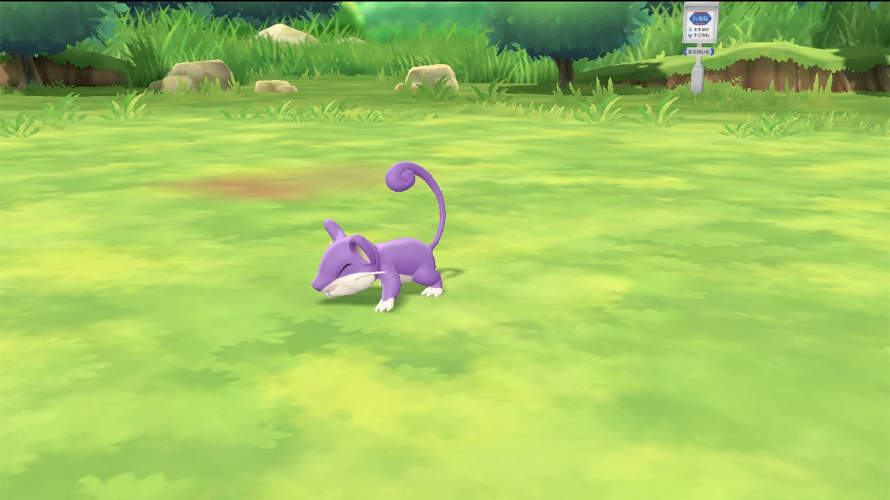
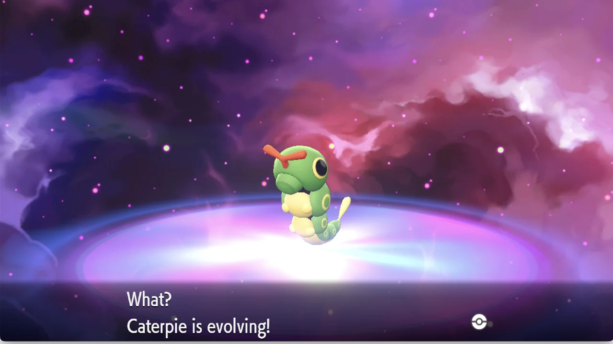
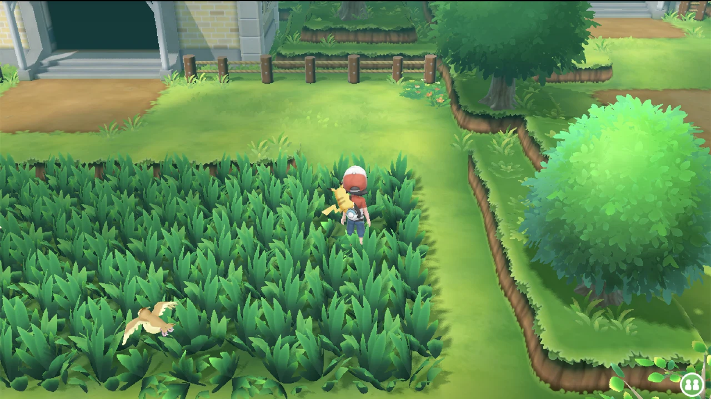
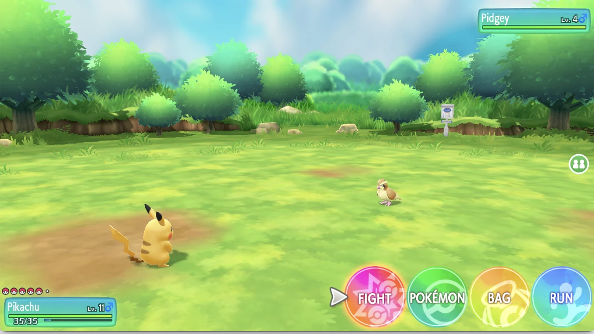

<div align="center">

<!-- Original banner (abstract art; no copyrighted game imagery). Source: docs/assets/banner.svg -->


# Wild Battles EXP

**Defeat a wild Pokémon → earn real experience.**
Native battle EXP for wild knockouts in *Pokémon: Let's Go, Pikachu!* — entirely through the game's own battle, faint, EXP and evolution code.

[](https://github.com/avishayil/wild-battles-exp/releases)
[](LICENSE.md)


</div>

> ⚖️ **Unofficial, non-commercial fan project — not affiliated with, endorsed, or sponsored by
> Nintendo, Game Freak, Creatures Inc., or The Pokémon Company.** All game trademarks and
> copyrights belong to their respective owners. **No game code, ROMs, or keys are distributed** —
> only original tooling and address-based patch descriptions; a legally owned copy of the game is
> required. The gameplay screenshots/recording below are self-captured, shown only to demonstrate
> the mod (© their rights holders; not under this repo's license). Read the full
> [legal notice](DISCLAIMER.md) before using this mod.

---

A static IPSwitch (`.pchtxt`) mod for **Pokémon: Let's Go, Pikachu! v1.0.2** (Switch, title
`010003F003A34000`, program NSO build-id `C208DB6A…`) that makes **defeating** a wild Pokémon
award normal battle **experience** — the way the main-series games do — on top of RicoSantos'
*Wild Battles* (PWB1) mod. There is **no custom XP formula and no modified emulator**.

```text
Walk into a wild Pokémon  →  battle it  →  KO it  →  it faints
  →  your party gains native EXP (real amounts, normal level-ups, evolutions)
  →  you return straight to the overworld (no catch screen)
```

Developed and verified on **Eden** (macOS, Apple Silicon / MoltenVK).

## Contents

- [Gameplay gallery](#gameplay-gallery)
- [What it does](#what-it-does)
- [How it works](#how-it-works)
- [Install](#install)
- [Status & known limitations](#status--known-limitations)
- [Roadmap](#roadmap)
- [Contributing & reproducing](#contributing--reproducing)
- [Repository layout](#repository-layout)
- [Legal](#legal) · [Credits](#credits)

## Gameplay gallery

> **Wild Battles EXP in action:** fight wild Pokémon with traditional turn-based battles, earn
> native experience when they faint, level up and evolve naturally, and return directly to
> exploration. *(This is the main **auto-exit** variant; the Catch Variant keeps the catch screen.)*

<div align="center">



*One continuous wild battle: attack → the wild Pokémon faints → your party earns real EXP → straight back to exploration, no catch screen.*

</div>

### Traditional wild battles · real EXP

<table>
<tr>
<td width="50%"><br><sub><b>Traditional wild battles</b> — turn-based, with the familiar Fight / Pokémon / Bag / Run menu.</sub></td>
<td width="50%"><br><sub><b>Real EXP from a wild KO</b> — actual amounts, awarded by the game's own code.</sub></td>
</tr>
</table>

### Battle → knockout → native EXP → evolution → exploration

<table>
<tr>
<td width="33%"><br><sub>Wild Pokémon <b>faint</b> naturally.</sub></td>
<td width="33%"><br><sub>Level-ups from wild EXP trigger <b>native evolution</b>.</sub></td>
<td width="33%"><br><sub>Back to <b>exploring</b> after a KO — no forced catch screen.</sub></td>
</tr>
</table>

<sub>The evolution shot is from a separate progression test, not necessarily the same encounter — not every knockout triggers an evolution.</sub>

<details>
<summary><b>More gameplay</b></summary>

<p align="center"></p>

<sub>Another species — a wild Pidgey battle with both HP bars and the full command menu visible.</sub>

</details>

> All gameplay images and the recording above were **self-captured by the maintainer** from a
> legally-owned copy, solely to demonstrate this mod. Game visuals and characters are © Nintendo /
> Game Freak / Creatures Inc. / The Pokémon Company and are **not** covered by this repo's MIT
> license. See [`DISCLAIMER.md`](DISCLAIMER.md).

## What it does

Wild battles created by PWB1 reuse the game's *legendary / Snorlax* "special battle" system,
which is wired to **end instantly with no faint and no EXP**. This mod flips that battle onto the
normal faint → reward path, fills the gaps the special-battle setup leaves behind, and **scopes
every change to PWB's own encounters** (via the `pwb_encounter` identity) so it is designed never
to touch a real battle.

> **Isolation — verified vs. still open.** Ordinary wild / trainer / flee / capture / blackout /
> save-reload are live-verified clean. Isolation against genuine **scripted special battles**
> (Snorlax, legendaries, the Power Plant Electrode) is **not yet live-tested** — the enclosing
> PWB setup is reached by virtual dispatch, so it can't be proven offline. This is the one open
> gate before a stable release; see [`docs/WBEXP_STATIC_CALLGRAPH.md`](docs/WBEXP_STATIC_CALLGRAPH.md).

| Piece | Hook (NSO offset) | Effect |
|---|---|---|
| **M** PWB marker | `0x3059B8` | Replays PWB's own per-encounter marker write and sets a `pwb_encounter` flag — true only during a PWB-synthesized wild battle. The identity every other hook keys off. |
| **A** faint | `0x28BF34` | Clears the legendary "instant-end" flag once the command menu exists **and `pwb_encounter` is set**, so a KO **faints**; also zeroes the 5-minute battle timer (v0.6, same gated path). |
| **C** model guard | `0xA9C650` | Returns "no joint" for a resource-less wild model (prevents a post-faint crash); **gated on `pwb_encounter`**. |
| **A2** XP | `0x9D8A30` | Forces EXP eligibility **only** for a PWB encounter matching the PWB profile; every other battle runs the game's untouched predicate. |
| **A3** exit | `0x28BD20` | On a **verified KO** (captured enemy HP == 0), rewrites the battle result so it ends **without** the catch screen (one-shot per encounter). |
| **A4** evolution | `0x319EC4` | Redirects the after-battle transition so a KO-induced level-up **evolves**; also clears `pwb_encounter` each battle. |

Details and the full debugging history are in [`docs/`](docs/) and [`research/`](research/).

## Install

You need the game dumped and running under an emulator that supports IPSwitch `.pchtxt` mods
(tested on Eden; Ryujinx/yuzu-family loaders use the same format). This targets **v1.0.2**
specifically — the update must be applied so the running program matches build-id `C208DB6A…`.

### From a release zip (recommended)
Grab **one** variant's zip from [**Releases**](https://github.com/avishayil/wild-battles-exp/releases).
In Eden: right-click the game → **Properties → Add-Ons → Import Mod from ZIP**, pick the zip,
enable it, disable any other variant, and restart the game.

| Variant | Behaviour |
|---|---|
| **Wild Battles EXP** (main) | wild KO → EXP → auto-exit to the overworld (no catch screen). |
| **Wild Battles EXP (Catch Variant)** | wild KO → EXP, but the normal **catch screen stays**. |
| **Add-on** | for people already running RicoSantos' *Wild Battles* — enable both. |

> ⚠️ **Enable exactly one** of the main / catch variants — each is a full build that already
> contains the base *Wild Battles* records; running two would double-apply them.

### Launch note (Eden / macOS)
Developed/tested launching Eden with MoltenVK workarounds, using the **Vulkan** renderer (a Null
renderer shows a black "Launching…" screen):

```sh
MVK_CONFIG_SYNCHRONOUS_QUEUE_SUBMITS=1 MVK_CONFIG_VK_SEMAPHORE_SUPPORT_STYLE=0 \
  "$HOME/Applications/eden.app/Contents/MacOS/eden"
```

## Status & known limitations

- ✅ Wild battle → faint → native EXP (measured, e.g. *"Pikachu got 12 Exp. Points!"*) → party
  distribution → clean return to the overworld.
- ✅ Consecutive encounters (per-encounter one-shot re-arms). No crashes.
- ✅ **Evolution** after a KO-induced level-up (Caterpie L6 → L7 → Metapod, native cutscene).
- ✅ **Trainer battles**: fully vanilla — no hook fires.
- ✅ **Flee / intentional catching** (Catch Variant): the result is left untouched; the marker
  clears on KO, capture and flee with no leak into the next battle.
- ✅ **Timeout / black-out / save → relaunch** (v0.5): a battle timeout and a party black-out
  award no false EXP; progress persists across a relaunch and the mod re-arms.
- ✅ **No 5-minute timer** in ordinary wild battles (v0.6) — the "MATCH TIME" limit is removed for
  PWB wilds only (verified >5 min with no timeout); genuine static battles keep their countdown.
- ⛔ **OPEN GATE — real legendary / scripted encounters (e.g. the Route 12/16 Snorlax):** PWB
  reuses that same battle system, so isolation is designed to exclude them, but this has **not
  been tested on a live static encounter yet** (the development save is early-game). Until that
  passes, don't rely on this mod during such a battle.
- ❓ A PP-consumption recheck and the Catch-Variant double-EXP measurement remain optional.

**This is beta software — back up your saves.**

## Roadmap

- **v0.4.x — encounter isolation (done):** every behavior-changing hook is scoped to PWB's own
  per-encounter marker.
- **v0.5.0-beta — battle-engine stability (done):** opponent-identity / KO-ownership hardening
  and a replayable trace-assertion harness; KO/flee/trainer/timeout/black-out/save-reload all
  live-verified.
- **v0.6.0-beta — classic battles + modular builder (done):** the 5-minute wild-battle timer is
  removed; the generator is a hook-module registry with build-time profiles and a build manifest.
- **Next:** validate scripted **Snorlax and legendary** encounter isolation (the open
  static-encounter gate before a public beta); then the **Catch Variant** double-EXP check. EXP
  multipliers (75%/50%) are **deferred** pending identification of the actual EXP grant path (see
  `research/EXP_SEAM_INVESTIGATION.md`); an in-battle CATCH action and shiny/scripted edge cases
  are future work.

## Contributing & reproducing

Everything regenerates byte-for-byte from one source of truth:

```sh
python3 -I tools/build_patch.py --text text.bin --pwb pwb1.pchtxt \
  --out-addon addon.pchtxt --out-unified unified.pchtxt --out-catch-unified catch.pchtxt \
  --profile classic --manifest build-manifest.json
```
The generator is a hook-module registry; `--profile classic` (default) removes the wild-battle
timer, `timed` keeps it, and `--manifest` writes a build record (offsets, variants, hashes).

See [`CONTRIBUTING.md`](CONTRIBUTING.md) for the development environment, tooling, and the
build → verify → test loop; AI coding agents should also read [`AGENTS.md`](AGENTS.md).
The full function/field map is in [`docs/FUNCTION_MAP.md`](docs/FUNCTION_MAP.md), step-by-step
reproduction in [`docs/REPRODUCE.md`](docs/REPRODUCE.md), and the reasoning trail in
[`docs/ENGINEERING_LOG.md`](docs/ENGINEERING_LOG.md).

## Repository layout

```text
mods/        the installable mods — main unified · catch variant · add-on
tools/       build_patch.py (regenerates every patch) + gdbstub reader + packaging
docs/        ENGINEERING_LOG · REPRODUCE · FUNCTION_MAP · WBEXP_STATIC_CALLGRAPH · status/
docs/media/  gameplay screenshots + demo GIF (+ how they were made); docs/assets/ holds the banner
research/    raw experiment log, investigation notes, original findings, hook research
CONTRIBUTING.md · AGENTS.md · CLAUDE.md   dev + AI-agent guides
CHANGELOG.md · CREDITS.md · DISCLAIMER.md · LICENSE.md
```

## Legal

Unofficial, non-commercial fan project, **not affiliated with or endorsed by Nintendo, Game
Freak, Creatures Inc., or The Pokémon Company**. All game trademarks and copyrights belong to
their respective owners. This repository contains **no game code, assets, or keys** — only
original tooling and address-based patch descriptions created through independent
interoperability research. A legally owned copy of the game is required. Full notice:
[`DISCLAIMER.md`](DISCLAIMER.md). The original tooling, docs, and patch descriptions here are
MIT-licensed ([`LICENSE.md`](LICENSE.md)); the license grants no rights in any game IP.

## Credits

Base **Wild Battles (PWB1)** mod by **RicoSantos**. Native-EXP mechanism and address map derived
with reference to **[raulzrrs/letsgo-recomp](https://github.com/raulzrrs/letsgo-recomp)** (a
recompiler for the Eevee 1.0.0 build) — this project ports the same ideas to the Pikachu 1.0.2
executable as a static `.pchtxt`. See [`CREDITS.md`](CREDITS.md).
